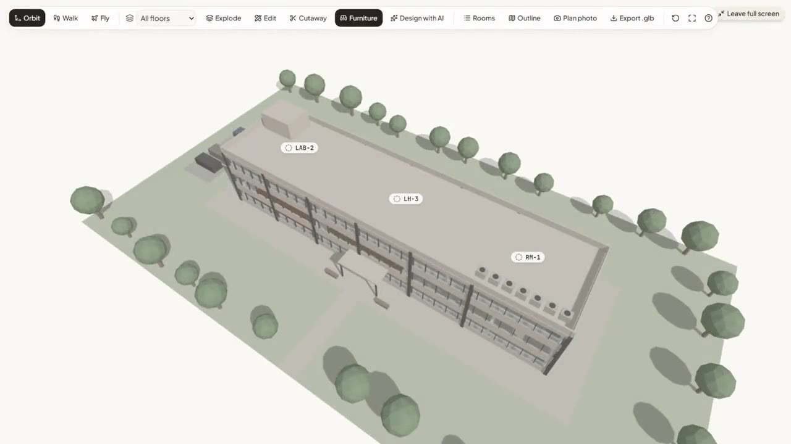
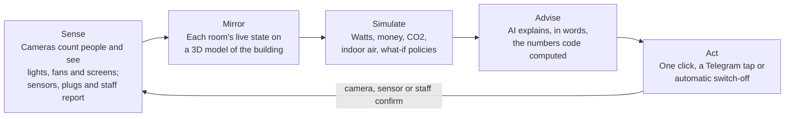
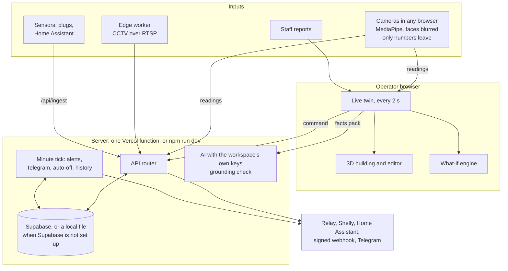
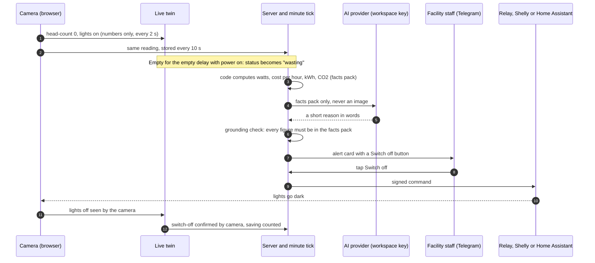
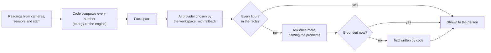
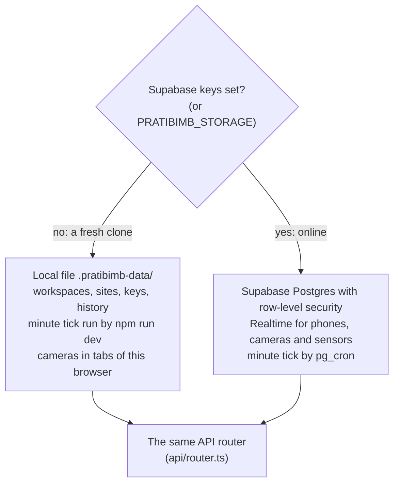
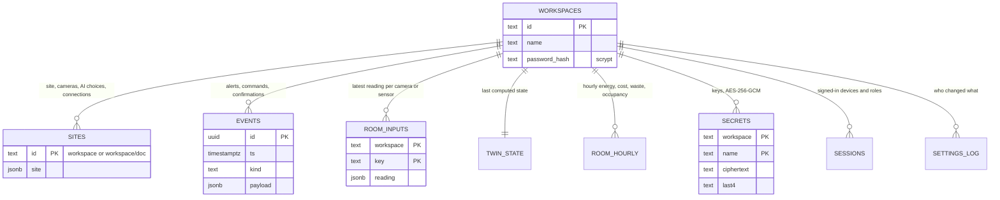
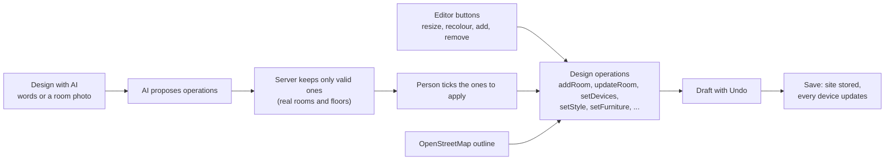

# Pratibimb

**A live digital twin for any building. Cameras you already own find empty rooms wasting power, the twin shows what that costs in money and CO₂, and AI tells the facility manager exactly what to fix, then helps switch it off.**

**Team Barfi** · Code Clash 2.0 · Problem Statement 04: Green Building Digital Twin

*Pratibimb* is Sanskrit for *reflection*: the twin reflects the building's live state back to the people who run it.

**Live:** [code-clash-2-0.vercel.app](https://code-clash-2-0.vercel.app/)

## Demo video

[](docs/media/pratibimb-demo.mp4)

**[Watch the 4-minute demo (MP4, 11 MB)](docs/media/pratibimb-demo.mp4).** It shows the whole loop recorded from the real app: a camera counting people with only numbers leaving it, the 3D twin you can walk through and edit, the AI designer, the Assistant answering from live data, the Scenario Lab, automatic switch-off and the audit report. Stock footage appears only in the opening scenes and as the video a camera reads.

---

## Contents

- [Demo video](#demo-video)
- [The problem](#the-problem)
- [What Pratibimb does](#what-pratibimb-does)
- [How it meets Problem Statement 04](#how-it-meets-problem-statement-04)
- [Run it in two minutes](#run-it-in-two-minutes)
- [A tour of the product](#a-tour-of-the-product)
- [Screens](#screens)
- [Architecture](#architecture)
- [How it works](#how-it-works)
- [The 3D view](#the-3d-view)
- [API overview](#api-overview)
- [Tech stack](#tech-stack)
- [Quality, testing and security](#quality-testing-and-security)
- [Repository map](#repository-map)
- [Documentation](#documentation)
- [Put it online](#put-it-online)
- [Team](#team)
- [How we built it](#how-we-built-it)
- [Research we build on](#research-we-build-on)
- [License](#license)

---

## The problem

Buildings use about a third of India's electricity, and much of a campus's or office's share lights and cools rooms nobody is in. Nobody sees that waste while it happens, so nobody fixes it. Energy audits, including NAAC metric 7.1.6 for Indian colleges, are still a once-a-year snapshot.

A US EPA study of 158 rooms in 60 buildings found that occupancy-based switching with a 5-minute delay cut classroom energy waste by 63 % (58 % energy savings). The idea is proven. What buildings lack is a way to see and act on the waste without rewiring every room.

## What Pratibimb does

It runs one loop, every two seconds in the browser and every minute on the server, so it keeps working when nobody has the app open:



## How it meets Problem Statement 04

| The statement asks for | Pratibimb |
| --- | --- |
| A digital twin of a building | Any building, described once in Setup, in plain words to the AI, from a photo of its floor plan, or generated from its real OpenStreetMap outline. Shown as a 3D building you can walk through and edit, live, with time travel, what-if policies and commands sent back to the building |
| Computer vision for occupancy | In-browser person detection on any camera (laptop, phone, USB, CCTV), counted inside a marked room boundary; faces blurred; no image stored or sent |
| Computer vision for lighting | Light zones read by brightness against on and off references, relative to a wall patch so daylight does not fool them; lights found automatically by switching them off and on once |
| Computer vision for resource usage | Fans read by motion, projectors and screens by brightness and detection; meters, smart plugs and Home Assistant through an API; coverage shown per room ("2 of 4 lights watched") |
| GenAI recommendations: energy efficiency | Alert cards with a fix written by code and a reason written by the AI; recurring waste patterns explained; an Assistant that answers questions about the building and runs what-ifs |
| GenAI recommendations: indoor sustainability | Indoor CO₂ measured by sensors or estimated from head-counts, with ventilation advice checked against outdoor air quality; AC advice when it is mild outside or a room is overcooled |
| GenAI recommendations: resource utilization | Observed room-by-hour use, underused large rooms, a "move small classes" policy, and an audit report written from the measured facts |

## Run it in two minutes

You need [Node.js](https://nodejs.org/) 20.19 or newer.

```bash
git clone https://github.com/rishushaurya/Code_clash_2.0.git
```

```bash
cd Code_clash_2.0
```

```bash
npm install
```

```bash
npm run dev
```

Open `http://localhost:5173`.

**No account and no key is needed.** A fresh copy keeps its workspaces, building, keys and history in a local file (`.pratibimb-data/`, ignored by git) and runs the twin's minute tick itself. Then:

1. **Create a workspace** with a name and a password.
2. **Describe the building** in Settings, Site: add rooms from templates, or press **Set up with AI** and say it in plain words.
3. **Open Building 3D.** The building is drawn from your rooms. Press **Edit** to resize, recolour, add or remove anything.
4. **Open Cameras**, add your laptop camera for a room, and walk in and out of view. The room turns red when it is empty with the lights on.
5. **Add your own AI key** in Settings, Keys and AI (Groq and Google Gemini have free plans) to turn on the Assistant, the AI designer and AI-written reports. Without a key every AI feature falls back to text written by code.

To run the checks:

```bash
npm test
```

To put it online with phones as cameras, Telegram and the 24/7 server tick, follow [docs/DEPLOY.md](docs/DEPLOY.md). Every service it uses has a free plan.

## A tour of the product

### Sense: cameras that only send numbers

- Any camera works: laptop, USB, a phone on a tripod (scan a QR code), or campus CCTV through MediaMTX or the Python edge worker.
- Person detection runs in the browser with MediaPipe. Faces are blurred before anything is drawn. Each camera sends one small JSON message every two seconds: room, head-count, which zones are on, confidence. The camera page shows that exact message next to "Images stored: 0".
- **Auto-find:** switch the lights off and on once and the camera proposes a zone for each fixture; ten seconds of a running fan finds the fan.
- Several cameras per room and per device, each with its own zones; a health line per camera (frame rate, last detection, too dark to count); an alert when a camera goes quiet.
- Devices a camera cannot see, in a room it watches, take the state of the ones it does see of the same type, marked **Inferred**, and anyone can override them.

### Mirror: a 3D building you can walk into and edit

- The building is generated from the site: floors, rooms, walls with doors, windows on outside walls, a facade with glass bands and columns, a roof with parapet and AC condensers, an entrance, and grounds with trees, a path and parking.
- Rooms show their live status (occupied, emptying, idle, wasting power, no data) with icon and text, people counts, lights lit and fans turning as the camera sees them.
- **Orbit, walk or fly.** Walk in at head height with the keyboard or a touch joystick; walls stop you. Cutaway lifts the facade and roof. Full screen. Export the model as `.glb`.
- **Edit everything:** rename, retype, resize, turn, duplicate, move to another floor or remove a room; add rooms and floors; place each light, fan, AC, projector and camera where it really is; recolour walls and floors; add or rearrange furniture. Undo, then Save, and every device of the workspace shows the change.
- **Design with AI:** "add a 40-seat classroom on the second floor with 2 ACs", or a photo of a room with "make the Library look like this". The AI proposes a list of changes; you tick the ones to apply.
- **From the map:** find the building on OpenStreetMap and generate floors and rooms inside its real outline as a starting point. A floor plan photo (the evacuation map on the wall) can reshape the rooms too.

### Simulate: what-ifs you can trust

- The Scenario Lab compares policies (auto-off after N empty minutes, daylight harvesting, moving small classes, all together) against today over 20 modelled weeks on shared random seeds, and reports ranges, not one suspicious number.
- Business case: payback, energy intensity (EPI), and rooftop solar from the sunshine measured at your location. Every modelled figure is labelled **Modelled**.

### Advise: AI that writes words, never numbers

- Code computes every number. The AI gets a facts pack and the server rejects any money, energy, CO₂, ppm, temperature, people or percent figure that is not in it, asks once more, and otherwise uses text written by code.
- **Assistant** in a side panel on every page: explains any number and where it came from, finds rooms with no inputs and walks you through connecting them, proposes changes you approve, runs what-ifs, teaches (kWh, EPI, BEE, NAAC 7.1.6), and gives exact step-by-step help for any page from this workspace's real setup. Its four natural voices download once, in the background, and run on your device; the microphone shows a live level meter while it listens.
- **Audit report** for energy and green audits, printable as PDF, with the stored 30-day action log; **weekly digest** to Telegram.
- **Bring your own keys:** each workspace adds its own keys (Groq, Gemini, OpenAI, Anthropic, OpenRouter or any OpenAI-compatible service) and chooses which one handles chat, reports, photos and voice, with a fallback order. Keys are encrypted on the server and never shown again.

### Act: from advice to a switch going off

- One click on an alert card, a tap on the Telegram alert, or **automatic switch-off** after N empty minutes (with exempt rooms).
- Commands reach a USB relay (Web Serial), Shelly smart plugs, Home Assistant, or any control system through a signed webhook.
- A saving counts only once a camera, sensor or person confirms the devices went off.

### Built for real sites

- **Real data only.** A fresh install has no rooms and no numbers. A room nobody watches shows **No data**.
- **Any site:** any currency, tariff and grid factor (India, UK, US and Singapore prefill with sources); one building or a campus; alerts in English, Hindi or Kannada.
- **Workspaces and roles:** many teams on one deployment, each seeing only its own building; owner, manager and viewer roles; invite links; signed-in devices you can sign out.
- **Connection doctor** checks every key, plug, bot and camera and says exactly what to fix.
- **Public view** behind a QR code, with a "Lights left on here?" button for anyone passing by.

## Screens

| Group | Screen | Path | What it is for |
| --- | --- | --- | --- |
| Monitor | Overview | `/` | Health score, power, cost, waste, today's three actions, set-up checklist, live 3D |
| Monitor | Building 3D | `/building` | The 3D twin: orbit, walk, edit, design with AI |
| Monitor | Rooms | `/rooms`, `/room/:id` | Every room's status, people, power, inputs and camera coverage |
| Monitor | Alerts | `/alerts` | Open, acknowledged and resolved alerts with their evidence and fix |
| Analyse | Scenario Lab | `/lab` | What-if policies, payback, solar, utilization |
| Analyse | Reports | `/reports` | Audit report, PDF, activity log with CSV |
| Analyse | Trends | `/trends` | Day, week and month history |
| Connect | Cameras | `/camera` | Camera station, zones, auto-find, privacy inspector |
| Connect | Connections | `/connections` | Every input and output, plugs and Home Assistant entities per room |
| Connect | Connection doctor | `/connections/doctor` | Every check and its fix |
| Settings | Site | `/settings/site` | Building, money, hours, floors, rooms, devices, import and export |
| Settings | Keys and AI | `/settings/keys` | Your own AI, Telegram, maps, plug and webhook keys |
| Settings | Team | `/settings/team` | Roles, invite links, devices, password, export and delete |
| | Public view | `/live` | What visitors see from the QR code; no sign-in |

## Architecture



- **Where data lives:** with Supabase keys, in Supabase (Postgres with row-level security, and Realtime for phones). Without them, in `.pratibimb-data/` on the computer running `npm run dev`. `PRATIBIMB_STORAGE` can force either.
- **One server function:** the whole API is `api/router.ts`, so it fits Vercel's free plan; the dev server runs the same router.

## How it works

### From an empty room to a confirmed switch-off



### Code computes, the AI writes words



### Where data lives



| Capability | Fresh clone, no keys | Clone with an AI key in Settings | Online (Supabase and Vercel) |
| --- | --- | --- | --- |
| Workspaces, building setup, 3D model and editing | Yes | Yes | Yes |
| Cameras on this computer, live twin, alerts | Yes | Yes | Yes |
| Scenario Lab, reports, activity log, history | Yes | Yes | Yes |
| Minute tick: alerts and auto-off with the page closed | While `npm run dev` runs | While `npm run dev` runs | Always (pg_cron) |
| AI-written reasons, reports, Assistant, AI designer | Text written by code | Yes | Yes |
| Phones as cameras, sensors over the internet | No | No | Yes |
| Telegram alerts, Shelly, Home Assistant | With their keys | With their keys | Yes |

### The data model



### Editing the building

Every change to the building, whether made with the editor's buttons or proposed by the AI designer, is one of a small set of design operations, applied by the same pure function and reviewed before it is saved.



## The 3D view

| Key | Action |
| --- | --- |
| 1, 2, 3 | Orbit, walk, fly |
| W A S D or arrows | Move; Shift for faster |
| Q, E | Turn |
| Space, C | Fly up, down |
| K | Cutaway: lift the facade and roof |
| X | Explode the floors |
| L | Room list |
| Z | Undo the last edit |
| 0 | Reset the view |
| Esc | Cancel, close, back to orbit |

On a phone, a joystick appears for walking and dragging looks around.

## API overview

Every route is a Web-standard handler in `api/_routes/`, reached through one function, `api/router.ts`. Private routes need the workspace session (`Authorization: Bearer`); writes need the manager or owner role.

| Route | Purpose |
| --- | --- |
| `POST /api/workspace` | Create, open or join (invite) a workspace; `GET` its channels and sensor key; `DELETE` it |
| `PUT /api/workspace/password`, `POST /api/workspace/invite`, `GET /api/workspace/export` | Change the password, make role invite links, export every stored row |
| `GET`, `PUT /api/site` | The building |
| `GET`, `PUT /api/cameras` | Camera settings, one camera at a time |
| `POST /api/reading` | Camera readings (numbers only) |
| `POST /api/ingest` | Sensor readings, with the workspace's sensor key |
| `GET /api/state`, `GET /api/history` | The last computed twin, hourly history |
| `POST /api/command`, `POST /api/alert` | Send a switch-off; send an alert to Telegram |
| `GET`, `PUT`, `DELETE /api/keys`, `POST /api/keys/test`, `PUT /api/keys/ai` | Bring your own keys, test them, choose providers |
| `GET`, `PUT /api/connections` | Smart plugs and Home Assistant entities per room |
| `POST /api/telegram/connect`, `POST /api/telegram` | Connect a bot; the bot's webhook |
| `GET /api/doctor`, `GET /api/status`, `GET /api/health` | Connection checks, what is set up, uptime |
| `POST /api/tick`, `GET /api/digest` | The minute tick and the weekly digest (server secret) |
| `POST /api/ai/recommend`, `report`, `copilot`, `setup`, `surveyor`, `floorplan`, `design`, `transcribe` | The AI features, all grounded or checked |
| `GET`, `POST /api/events`, `POST /api/report` | The action log; a visitor's "lights left on" report |

## Tech stack

| Layer | Technology |
| --- | --- |
| Frontend | React 19, Vite 8, TypeScript (strict), Tailwind 4, shadcn/ui, lucide-react |
| 3D | three.js, React Three Fiber, drei, three-mesh-bvh |
| Computer vision | MediaPipe Tasks Vision (Apache-2.0), models served locally |
| Twin and simulation | Zustand, plain TypeScript, seeded Monte Carlo |
| Storage and realtime | Supabase Postgres and Realtime, or a local JSON file; `BroadcastChannel` between tabs |
| AI | Groq, Gemini, OpenAI, Anthropic, OpenRouter or any OpenAI-compatible API, with the workspace's own keys; Zod-validated answers; Kokoro voice on the device |
| Integrations | Ingest API, Shelly Cloud, Home Assistant, HMAC-signed webhook, Telegram Bot API, Web Serial relay, MediaMTX, Python edge worker, OpenStreetMap, Open-Meteo |
| Hosting | Vercel, with CSP and security headers |

## Quality, testing and security

- **213 automated tests** (`npm test`) cover the energy and CO₂ maths, camera merging, light and fan zones, auto-find and coverage, the full twin loop, the what-if engine, the 3D model and every design operation, grounding and the AI fallbacks, every API route through the router (workspaces, roles, isolation between workspaces, keys, the tick), and a full journey on local storage with no Supabase.
- `tests/journey.mjs` drives the whole API against a running server and cleans up after itself.
- Strict TypeScript across app and server; `npm run lint` with no errors.
- An axe-core audit of every page in light and dark themes; status is never shown by colour alone; every page works at 375 px wide.
- **Security:**
  - workspace passwords hashed with scrypt; HMAC-signed sessions; roles enforced on every write;
  - customer keys encrypted with AES-256-GCM under a per-workspace key, never returned to the browser, never logged;
  - addresses customers type in are checked so the server cannot be pointed at a private network;
  - a private live channel per workspace and a separate snapshot-only public channel;
  - a sensor key per workspace; Telegram's secret header; HMAC on outgoing commands;
  - Zod validation and size limits on every request; rate limits; CSP and security headers;
  - no secrets in the repository.

## Repository map

```
.
├── src/
│   ├── ai/            AI client, offline templates, Assistant tools, report facts
│   ├── cv/            camera station, detector, zones, auto-find, coverage
│   ├── relay/         USB relay over Web Serial
│   ├── shared/        shared types, constants, the site model, the signed-in workspace
│   ├── sim/           what-if engine
│   ├── twin/          live twin, energy and CO₂ maths, rules, realtime
│   ├── ui/            app shell, pages, components
│   │   ├── 3d/        the 3D building, editor and AI designer
│   │   └── assistant/ the Assistant panel and voice
│   └── components/ui/ shadcn/ui components
├── api/
│   ├── router.ts      the one server function
│   ├── _lib/          auth, storage (Supabase or local), keys, AI providers, grounding
│   └── _routes/       one file per route; ai/ for the AI routes
├── edge/              Python edge worker for CCTV
├── firmware/relay/    relay sketch for Arduino or ESP32
├── supabase/          database schema
├── tests/             end-to-end API journey
├── docs/              documentation
└── public/            static files and the vision models
```

| Area | Owner |
| --- | --- |
| Computer vision, cameras, relay, edge worker, sensor ingest, Telegram | Aditya Raj |
| Twin, simulation, AI, server and storage, shared model | Priyanshu Shaurya |
| Interface, 3D presentation, design system, public view, pitch | Neev Pujari |

## Documentation

| Document | Read it for |
| --- | --- |
| [docs/USER_GUIDE.md](docs/USER_GUIDE.md) | Step by step: run it, set up a building, connect cameras, use every screen |
| [docs/DEPLOY.md](docs/DEPLOY.md) | Putting it online for free: Supabase, Vercel, keys, Telegram, the 24/7 tick |
| [docs/INTEGRATIONS.md](docs/INTEGRATIONS.md) | Site file, sensor API, Shelly, Home Assistant, command webhook, CCTV |
| [docs/BUILD_SPEC.md](docs/BUILD_SPEC.md) | Contracts, data rules, module checks, security |
| [docs/DESIGN_SYSTEM.md](docs/DESIGN_SYSTEM.md) | Theme, tokens, status language, app shell, the 3D twin, accessibility |
| [docs/TEST_REPORT.md](docs/TEST_REPORT.md) | What was tested and the results |
| [docs/RESEARCH_MASTER_PLAN.md](docs/RESEARCH_MASTER_PLAN.md) | The research behind the design, with sources |
| [docs/SITE_SURVEY.md](docs/SITE_SURVEY.md) | Worksheet for onboarding a new building |
| [CHANGELOG.md](CHANGELOG.md) | Release notes |

## Put it online

Copy `.env.example` to `.env` (local) or set the same values in Vercel (online). Every value is optional. [docs/DEPLOY.md](docs/DEPLOY.md) covers Supabase (run `supabase/schema.sql` once), Vercel, the minute tick, AI keys and Telegram, with a check for every feature.

## Team

| Member | Module |
| --- | --- |
| **Priyanshu Shaurya** | Digital twin, simulation engine, generative AI, server (Mirror, Simulate, Advise) |
| **Aditya Raj** | Computer vision, cameras, relay hardware, sensors, Telegram (Sense, Act) |
| **Neev Pujari** | User interface, setup, public view, design, pitch (Show) |

## How we built it

We wrote the contracts first ([docs/BUILD_SPEC.md](docs/BUILD_SPEC.md)) and built the modules with AI coding assistants, one module per person. Every module was run and checked by its owner, who can explain every file. Libraries and pretrained models are used as libraries; no other project's application code was copied.

## Research we build on

- US EPA occupancy sensor study, 158 rooms in 60 buildings ([EC&M summary](https://www.ecmweb.com/contractor/epa-study-shows-occupancy-sensors-reduce-energy-waste-demand))
- Tien et al., camera-based occupancy and equipment detection ([Energies](https://doaj.org/article/3ef96fc779284e3c8572d37cf2e4f008))
- Camera-based occupant activity detection in a university building ([Applied Energy, Cardiff ORCA](https://orca.cardiff.ac.uk/178040))
- Building vocabulary from [Brick Schema](https://brickschema.org/)
- Geocoding, weather and air quality from [Open-Meteo](https://open-meteo.com) (CC BY 4.0); building outlines from [OpenStreetMap](https://www.openstreetmap.org/copyright) (ODbL)

## License

MIT, see [LICENSE](LICENSE): anyone may clone, run, change and share this code, keeping the licence notice. The MediaPipe models are Apache-2.0 and the Kokoro voice model is Apache-2.0.
