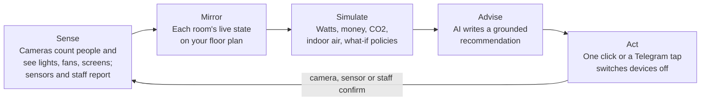
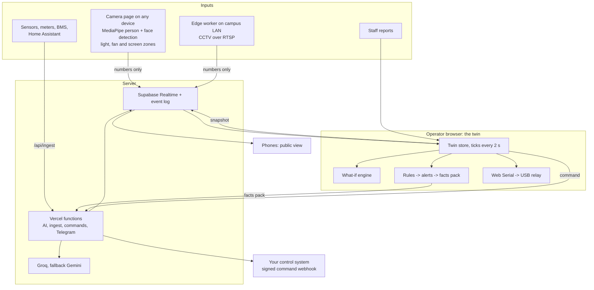

# Pratibimb

**A live digital twin for any building. Cameras you already own find empty rooms wasting power, the twin shows the cost and CO₂, and AI tells the facility manager exactly what to fix.**

**Team Barfi** · Code Clash 2.0 · Problem Statement 04: Green Building Digital Twin

> *Pratibimb* (Sanskrit for *reflection*) — because the twin reflects the building's live state back to the people who run it.

---

## Table of Contents

- [The Problem](#the-problem)
- [What Pratibimb Does](#what-pratibimb-does)
- [Key Features](#key-features)
- [Quick Start](#quick-start)
- [Screens](#screens)
- [Architecture](#architecture)
- [Tech Stack](#tech-stack)
- [Quality and Testing](#quality-and-testing)
- [Repository Map](#repository-map)
- [Documentation](#documentation)
- [Deployment](#deployment)
- [Team Barfi](#team-barfi)
- [How We Used AI Tools](#how-we-used-ai-tools)
- [Research We Build On](#research-we-build-on)
- [License](#license)

---

## The Problem

Buildings use about a third of India's electricity, and much of a campus's or office's share lights and cools rooms nobody is in. Nobody sees this waste while it happens, so nobody fixes it. Energy audits, including NAAC metric 7.1.6 for Indian colleges, are still a once-a-year snapshot.

A US EPA study of 158 rooms in 60 buildings found that occupancy-based switching with a 5-minute delay cut classroom energy waste by **63%** (58% energy savings). The control idea is proven. What buildings lack is a way to see and act on the waste without rewiring every room.

## What Pratibimb Does

Pratibimb runs one loop every two seconds:



### How We Match the Problem Statement

| Problem Statement Requirement | Pratibimb's Solution |
| --- | --- |
| Digital twin of a building | Any building: describe it once in Setup (or import a JSON file), see it live, run it forward in the Scenario Lab, send commands back |
| CV for occupancy | In-browser person detection on any camera: laptop, phone, USB, CCTV; faces blurred, no image stored or sent |
| CV for lighting | Light zones read by brightness against on/off references |
| CV for resource usage | Fan zones read by motion, projector screens by brightness, plus sensors and meters through an API |
| GenAI recommendations for energy efficiency | Alert cards with a one-click fix and a saving from the simulation engine; observed waste patterns ("LH-1, Fridays at 16:00") explained by the AI |
| Indoor sustainability | Indoor CO₂ measured by room sensors when present, otherwise estimated from live head-counts, with ventilation advice checked against outdoor air quality; AC advice when the outdoor air is already below the 24 °C BEE default |
| Resource utilization | Observed room-by-hour utilization, underused large rooms, and a "move small classes" policy |

---

## Key Features

### Real Data Only
A fresh install has no rooms and no numbers. Every live figure comes from an observed input: a camera, a connected sensor or meter, or a staff member reporting what they see. A room nobody watches shows **No data**, and a device nobody observes draws nothing in the totals. A switch-off counts as saved money only after a camera, sensor or person confirms the devices went off. The only modelled numbers are the Scenario Lab's what-ifs, built from your own rooms and assumptions and labelled **Modelled**.

### Grounded AI
Code computes every number. The AI only writes words. It receives a *facts pack* from the twin, and the server rejects any money, kWh, kg, ppm, watt or percent figure that is not in that pack, asks once more, and otherwise falls back to a template written by code. Without any AI key, every AI feature still works from templates.

### Privacy by Design
Video never leaves the device. Detection runs in the browser (or on an edge box inside the campus network), faces are blurred before anything is drawn, and only a small JSON message is sent: room id, head-count, zone states, confidence. The camera page shows that exact message next to "Images stored: 0" and "Images sent: 0".

### Built for Any Site
- **Setup in minutes:** search your city (Open-Meteo geocoding), pick a currency, enter the tariff from your bill, add rooms from templates, then match counts to reality. Indian locations prefill INR, the BESCOM educational rate and the CEA grid factor.
- **One building or a whole campus:** floors can carry a building name, and the twin, league and 3D view group by it.
- **Any currency, any tariff, any grid factor.** Alerts in English, Hindi or Kannada.
- **Integrates with what you have:** a sensor API for building systems, smart plugs and Home Assistant; a signed command webhook for your control system; Telegram for staff; CCTV through MediaMTX or the Python edge worker. See [docs/INTEGRATIONS.md](docs/INTEGRATIONS.md).
- **Your data in a portable file:** export and import the site as JSON, with Brick Schema device classes. With server storage, every device shares it automatically.
- **Everyone can help:** the public view behind each room's QR code has a "Lights left on here?" button that asks staff to check, without changing any reading.
- **Your hours, your week:** opening hours and days in Setup shape every what-if.
- **Automatic switch-off when you are ready:** turn it on in Setup after trying it in the Scenario Lab; the twin then switches off rooms left empty with power on, through your relay or control system, once per room until people return. Labs and server rooms can be kept out.
- **Knows when a camera drops out:** a "Camera offline" alert, with a fix-it card, when a room's camera goes quiet; each room lists its cameras with live status and confidence.
- **Phones make good cameras:** the camera page keeps the screen awake while it watches, and Pratibimb installs to the home screen.
- **Uptime-ready:** `/api/health` reports server and storage health for monitoring.
- **A weekly digest** goes to Telegram every Monday from the stored events.
- **Learns your building:** after a few hours of observation, Setup suggests your real opening hours and how often empty rooms stay on.
- **Activity log for auditors:** every alert, command and confirmation, filterable and downloadable as CSV.
- **Audit trail:** with server storage, every alert, command and confirmation is kept, and the report includes the last 30 days of actions.
- **Rooftop solar what-if** from the sunshine measured at your location over the last three months.
- **Workspaces:** each team signs in with a workspace name and password; its building, cameras, live data, alerts and reports stay its own, so many customers share one deployment.
- **Set up with AI:** describe the building in plain words and the AI fills the setup form; numbers you did not write are left out, and nothing is saved until you review it.
- **Many cameras, any device:** one laptop runs several cameras, one room can have several, and a QR code turns a phone into a camera in seconds.
- **Grid factors with sources:** India (CEA), UK (DESNZ), US (EPA eGRID) and Singapore (EMA) prefill on location search.

---

## Quick Start

### Prerequisites
- [Node.js](https://nodejs.org/) (v20 or later)
- npm (comes with Node.js)

### Install and Run

```bash
# Clone the repository
git clone https://github.com/rishushaurya/Code_clash_2.0.git
cd Code_clash_2.0

# Install dependencies
npm install

# Start the development server
npm run dev
```

Open `http://localhost:5173`, create a workspace (kept in this browser when no server storage is set), go to **Setup**, add your rooms and save. Then open **Cameras**, add a camera for a room, and walk in and out of view.

**No API key is needed for any of this.** The entire twin loop — cameras, detection, twin, simulation, alerts, one-click fixes — runs locally in the browser.

### Run Tests

```bash
npm test
```

### Optional: Online Deployment

To put it online for free, with phones, AI and Telegram, follow [docs/DEPLOY.md](docs/DEPLOY.md). Every service it uses has a free plan.

---

## Screens

| Screen | Path | What It Does |
| --- | --- | --- |
| **Live Twin** | `/` | Floor plan, 3D view, time travel, alerts with one-click fixes, energy flow, Copilot |
| **Room** | `/room/<id>` | Devices on, off and not observed; staff reports; CO₂; camera QR code; AI Surveyor |
| **Cameras** | `/camera` | Several cameras per device and per room; zones per camera; every camera's live status; QR codes for phones; privacy inspector |
| **Scenario Lab** | `/lab` | What-if policies over 20 modelled weeks; payback; energy intensity; observed utilization |
| **Reports** | `/reports` | One-click audit report; Download PDF |
| **Setup** | `/setup` | Set up with AI; site, money, floors, rooms, devices, integrations, import and export |
| **Public View** | `/live` | What anyone sees after scanning the public QR code; no sign-in |

---

## Architecture



Without Supabase keys, the browser's `BroadcastChannel` links the camera, twin and public tabs on one machine, so the whole loop runs offline.

---

## Tech Stack

| Layer | Technology |
| --- | --- |
| Frontend | React 19, Vite 8, TypeScript (strict), Tailwind 4, shadcn/ui, lucide-react |
| Computer Vision | MediaPipe Tasks Vision (Apache-2.0), models served locally, CPU delegate |
| Twin and Simulation | Zustand, plain TypeScript, seeded Monte Carlo |
| Realtime and Storage | Supabase broadcast and Postgres; `BroadcastChannel` locally |
| AI | Groq and Gemini through their OpenAI-compatible APIs, Zod-validated, grounding check |
| Integrations | Ingest API, HMAC-signed command webhook, Telegram Bot API, MediaMTX, Python edge worker |
| Hosting | Vercel, with CSP and security headers |

---

## Quality and Testing

- **89 automated tests** (`npm test`) cover:
  - Energy maths, the CO₂ model, camera merging, light and fan zones
  - The full twin loop with real inputs only, and visitor reports that never touch device states
  - Sensor ingest, staff confirmation and unknown rooms
  - The what-if engine and the automatic floor layout
  - Grounding and the AI retry and fallback
  - Every API route through the router, including workspaces (hashing, signed sessions, forged and expired tokens), per-workspace isolation
  - Set up with AI: invented numbers dropped, injected text unable to change the answer's shape
  - Site sync that never overwrites an edit that failed to upload

- The Python edge worker has its own self-test.
- Person detection was checked on sample photos in the browser and in Python (person scores 0.98 and 0.95 in both).
- An axe-core accessibility audit finds no violations on any page, and every text colour meets WCAG AA contrast.
- Strict TypeScript across app and server. Every data panel has loading, empty, error and success states. Error boundaries keep one broken panel from blanking a page.
- **Security:**
  - Workspaces with scrypt password hashes and signed sessions; every private route acts only on the caller's workspace
  - A private live channel per workspace, named with a server-derived secret, and a separate snapshot-only public channel
  - A sensor key per workspace on ingest
  - Telegram's secret header on the webhook, and switch-off taps accepted only from the workspace's own chat
  - HMAC on outgoing commands
  - Zod validation and size limits on every request
  - Incoming realtime messages validated before use
  - Rate limits, CSP and security headers
  - No secrets in the repository

---

## Repository Map

```
pratibimb/
├── src/                    # Frontend source code
│   ├── ai/                 # AI client, offline templates, Copilot tools
│   ├── components/ui/      # shadcn/ui components
│   ├── cv/                 # Camera station, detector, device zones
│   ├── lib/                # Utility functions
│   ├── relay/              # Web Serial relay control
│   ├── shared/             # Shared types, config, site model
│   ├── sim/                # What-if simulation engine
│   ├── test/               # Test fixtures
│   ├── twin/               # Live twin store, energy, CO₂, rules
│   └── ui/                 # Pages, layout, 3D view, components
├── api/                    # Vercel serverless functions
│   ├── _lib/               # Auth, DB, grounding, LLM utilities
│   ├── _routes/            # API route handlers
│   │   └── ai/             # AI endpoints (recommend, copilot, report, setup)
│   └── router.ts           # API router
├── edge/                   # Python edge worker for CCTV
├── firmware/relay/         # Arduino relay firmware
├── docs/                   # All documentation
├── supabase/               # Database schema
├── scripts/                # Build scripts
├── public/                 # Static assets and ML models
├── tests/                  # Integration/journey tests
├── .env.example            # Environment variable template (safe to copy)
├── package.json            # Dependencies and scripts
├── vercel.json             # Vercel deployment config
├── vite.config.ts          # Vite build config
└── tsconfig*.json          # TypeScript configs
```

### Module Ownership

| Path | What It Holds | Owner |
| --- | --- | --- |
| `src/cv/`, `edge/` | Camera station (several cameras per device), per-camera settings, detector, device zones, camera sources; Python edge worker and MediaMTX config | Aditya |
| `src/relay/`, `firmware/`, `api/_routes/` (cameras, command, alert, telegram, ingest, report) | Relay, camera settings, commands, Telegram, sensor ingest, visitor tips | Aditya |
| `src/twin/` | Live twin store, energy and CO₂ maths, rules, camera merge, realtime, recorded utilization | Priyanshu |
| `src/sim/` | What-if engine and Monte Carlo | Priyanshu |
| `src/ai/`, `api/router.ts`, `api/_routes/ai/`, `api/_lib/` | AI client, offline templates, Copilot tools, AI endpoints (Set up with AI included), grounding check, the API router, workspace auth | Priyanshu |
| `src/shared/` | Shared types, engineering constants, the site model, the signed-in workspace | Priyanshu |
| `src/ui/` | Workspace sign-in, Live Twin, Room, Scenario Lab, Reports, Setup, Public view | Neev |
| `docs/` | Research, build spec, design system, integrations, deployment, user guide, site survey | All |

---

## Documentation

| Document | Read It For |
| --- | --- |
| [docs/RESEARCH_MASTER_PLAN.md](docs/RESEARCH_MASTER_PLAN.md) | The research: problem, prior work, design choices, sources, pitch, judge Q&A |
| [docs/DEPLOY.md](docs/DEPLOY.md) | Putting it online for free: GitHub, Supabase, Vercel, AI keys, Telegram |
| [docs/USER_GUIDE.md](docs/USER_GUIDE.md) | Step by step: run it, set up a building, connect cameras, use every screen |
| [docs/BUILD_SPEC.md](docs/BUILD_SPEC.md) | Contracts, ownership, data rules, module checks, security, camera options |
| [docs/INTEGRATIONS.md](docs/INTEGRATIONS.md) | Site file, sensor API, Home Assistant, command webhook, CCTV |
| [docs/DESIGN_SYSTEM.md](docs/DESIGN_SYSTEM.md) | Warm light theme, tokens, status language, screens, accessibility |
| [docs/SITE_SURVEY.md](docs/SITE_SURVEY.md) | The worksheet for onboarding a new building |
| [docs/TEST_REPORT.md](docs/TEST_REPORT.md) | Test report: feature checks, bug fixes, manual test results |
| [docs/PLAN.md](docs/PLAN.md) | The development plan: phases, rules, build sessions |
| [docs/LAUNCH_PLAN.md](docs/LAUNCH_PLAN.md) | Launch plan: workspaces, multi-camera, AI setup, free hosting |
| [CHANGELOG.md](CHANGELOG.md) | What was done, session by session |

---

## Deployment

### Environment Variables

Copy `.env.example` to `.env` and fill in your keys. Every key is **optional** — without keys the app runs on one machine with workspaces kept in the browser.

```bash
cp .env.example .env
```

See [docs/DEPLOY.md](docs/DEPLOY.md) for the full deployment guide covering:
- **Supabase** (free plan): Realtime channels, Postgres storage, workspace auth
- **Vercel** (free plan): Hosting, serverless functions, cron jobs
- **Groq / Gemini** (free tiers): AI recommendations, Copilot, reports
- **Telegram** (free): Alerts with switch-off buttons, weekly digest

### Vercel Deployment

1. Fork or import this repository on [Vercel](https://vercel.com)
2. Set the environment variables from `.env.example` in Vercel's project settings
3. Deploy — the `vercel.json` configures everything automatically

---

## Team Barfi

| Member | Module |
| --- | --- |
| **Priyanshu Shaurya** | Digital twin, simulation engine, generative AI, integration (Mirror, Simulate, Advise) |
| **Aditya Raj** | Computer vision, cameras, relay hardware, sensors, Telegram (Sense, Act) |
| **Neev Pujari** | User interface, setup, public view, design, pitch (Show) |

---

## How We Used AI Tools

We built Pratibimb with AI coding assistants, driven by the contracts in [docs/BUILD_SPEC.md](docs/BUILD_SPEC.md). Every module was run and checked by its owner, who can explain every file. Libraries and pretrained models are used as libraries; no other project's application code was copied.

---

## Research We Build On

- US EPA occupancy sensor study, 158 rooms in 60 buildings ([EC&M summary](https://www.ecmweb.com/contractor/epa-study-shows-occupancy-sensors-reduce-energy-waste-demand))
- Tien et al., camera-based occupancy and equipment detection ([Energies](https://doaj.org/article/3ef96fc779284e3c8572d37cf2e4f008))
- Camera-based occupant activity detection in a university building ([Applied Energy, Cardiff ORCA](https://orca.cardiff.ac.uk/178040))
- Building vocabulary from [Brick Schema](https://brickschema.org/)
- Geocoding, weather and air quality from [Open-Meteo](https://open-meteo.com) (CC BY 4.0)

---

## License

MIT, see [LICENSE](LICENSE). MediaPipe models are Apache-2.0.
